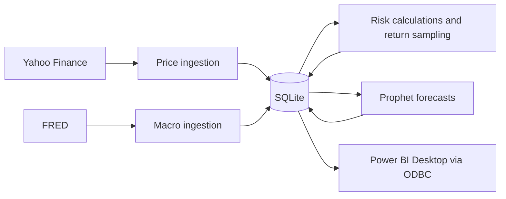

# Financial Risk Monitor

I built a batch pipeline that collects price data, calculates portfolio risk and prepares forecasts for a four-page Power BI report.

## The problem

Price history, risk calculations and forecasts were scattered across separate sources. I wanted one repeatable reporting path, with checks for failed downloads and incorrect calculations.

## What I built

Python ingestion scripts for Yahoo Finance and FRED (the Federal Reserve's economic data service), a six-table SQLite database, statistical risk calculations, Prophet price forecasts and a Power BI Desktop report. The configured universe contains 11 assets across equities, exchange-traded funds and cryptocurrencies. Macro indicators are collected but do not yet drive analytics.

## Architecture



## How it works

I initialize the database, fetch missing price and macro records, and write them using keys that prevent duplicate rows on repeated runs. Risk scripts calculate returns, volatility, drawdown and tail-risk measures. Forecasts and sampled portfolio paths are stored for the report to refresh through a SQLite database driver.

## ML / AI methodology

Prophet fits each asset's closing-price series and forecasts 30 future observations. Historical tuning uses rolling time windows, but there is no final held-out comparison against a simple forecast baseline. I therefore claim forecasting implementation, not demonstrated forecasting advantage.

The risk calculations are statistical methods, not trained models. Monte Carlo here means repeatedly sampling historical returns to explore possible portfolio paths. VaR (Value at Risk) is a lower-tail return threshold; CVaR averages returns beyond that threshold. Neither measures guaranteed future loss.

## Engineering

Incremental ingestion, repeated-run-safe writes, database transactions, logging, input validation, retries and service-failure tests exist. An offline CI workflow is committed; its presence does not establish a successful hosted run. The pipeline is manually run, without a scheduler or streaming service.

## Results

On 13 October 2026, **98 offline tests passed** in isolated Python 3.12. The synthetic demo writes three prices twice and retains exactly three rows. It checks +10% and −10% returns, a 10% drawdown and −9% historical VaR. These verify arithmetic and storage, not investment performance.

## Demo


This screenshot shows the Desktop report. There is no claimed live deployment. Run the offline demo below without API keys; a fresh live-data-to-Desktop refresh has not been verified.

## Run locally

The verified offline path uses Python 3.12 from the repository root:

```powershell
python -m venv .venv
.\.venv\Scripts\python.exe -m pip install -r requirements-lock.txt
.\.venv\Scripts\python.exe -m pytest tests/ -v
.\.venv\Scripts\python.exe -m scripts.offline_demo
```

For historical full-pipeline setup, see [FRED configuration](docs/fred_api_setup.md) and [refresh workflow](docs/data_refresh_workflow.md). That path needs network access, a FRED key, Power BI Desktop and a SQLite ODBC driver; it is outside the current verified offline run. Keep keys in an ignored local `.env` file using `.env.example` as the template.

## Repository structure

- `scripts/`: database initialization, ingestion, analytics orchestration and offline demo.
- `models/`: risk functions, return sampling and Prophet implementation.
- `tests/`: numerical, database and mocked-service checks.
- `dashboard/`, `assets/`, `docs/`: Desktop report, screenshots and refresh/schema documentation.
- `config.py`: assets, calculation settings and database path.

## Limitations

Prices reflect the last manual run. Macro records do not influence current calculations or visuals. Forecast tuning is not final holdout validation. Dashboard sliders use DAX, Power BI's formula language, to adjust existing scores; they do not rerun Python simulations. There is no measured financial benefit or production deployment claim.

## What I would improve next

1. Compare forecasts with a last-price baseline on a separate held-out period.
2. Record a permitted live ingestion and Desktop refresh with reconciled totals.
3. Connect macro indicators only after defining and testing their analytical use.

## My contribution

Repository history attributes ingestion, storage, risk, forecasting and dashboard implementation to my Tessa-Saumu/Theresia Saumu identity. Adeyeri Michael reviewed and merged changes. I do not claim sole participation in that review process.
