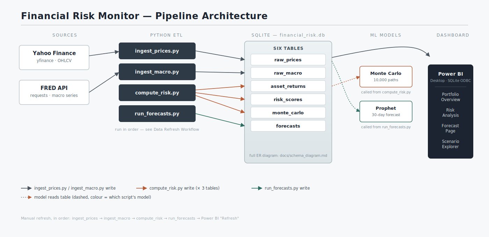
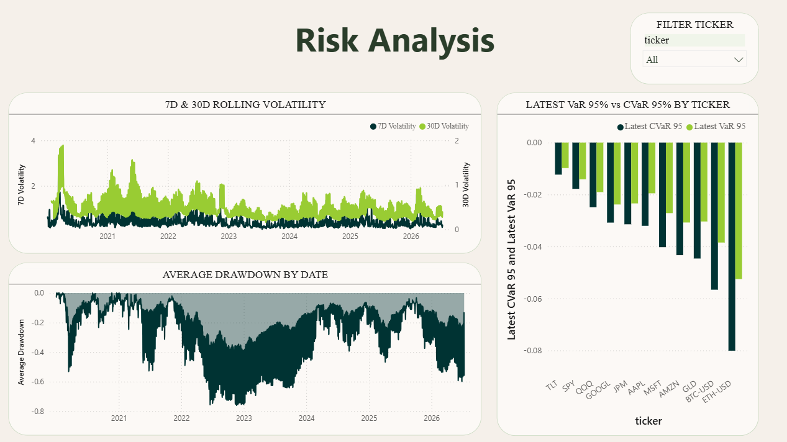
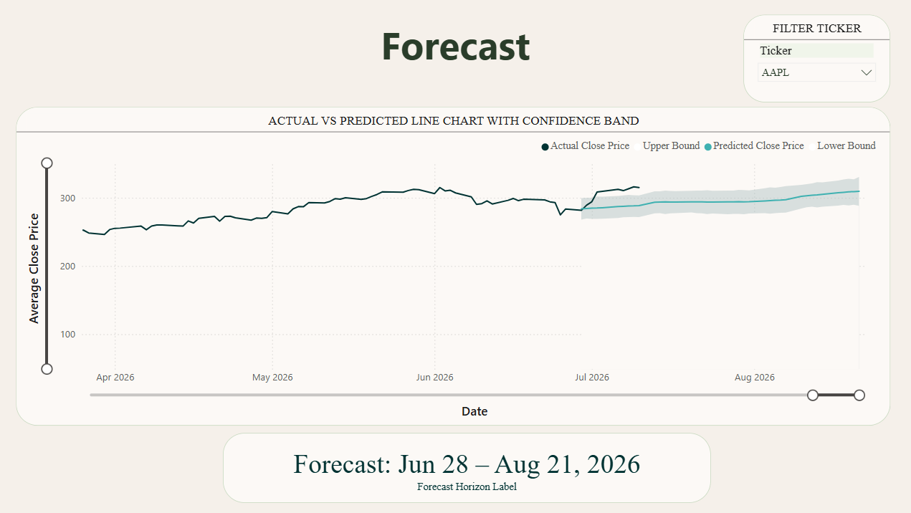
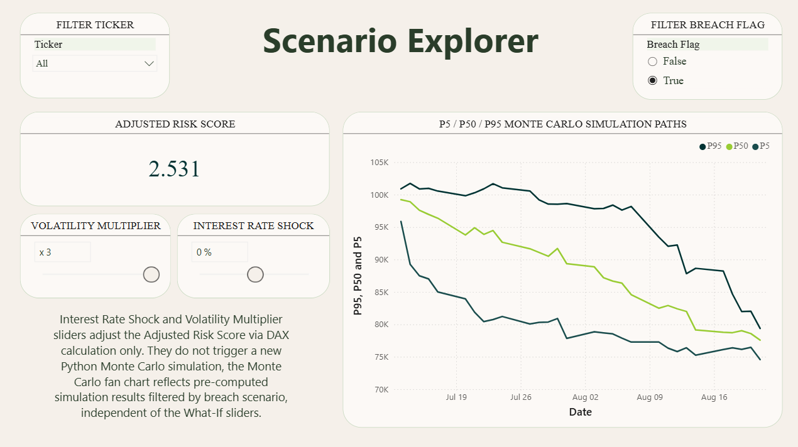

# Financial Risk Monitor

> An end-to-end financial analytics pipeline that ingests market and macroeconomic data, computes historical statistical risk metrics, runs Monte Carlo portfolio simulations, and serves a refreshable multi-page Power BI dashboard.

---

## Problem Statement

Investors and analysts monitoring multiple assets rarely have a single, unified view of
portfolio risk — especially one that incorporates macroeconomic context alongside price
behaviour. Raw price feeds are noisy, risk signals are scattered across tools, and forecasting
is often done manually or not at all. Volatility, drawdown, tail-risk measures like VaR and
CVaR, and forward-looking price outlooks each tend to live in a different spreadsheet or a
different mental model, which makes it hard to answer a simple question — "how risky is my
portfolio right now, and how would a rate shock change that?" — without stitching several
sources together by hand.

This project builds an automated, end-to-end pipeline that collects market and economic data,
applies historical risk calculations and a Prophet forecasting model, and presents risk-ready insights in a refreshable Power BI
dashboard. It ingests OHLCV price history from Yahoo Finance and macroeconomic indicators from
FRED into a structured SQLite database, computes a consistent set of risk metrics per asset
(returns, rolling volatility, drawdown, VaR, CVaR, and a combined 0–1 risk score), generates a
30-day Prophet forecast per asset with confidence bands, and runs a 10,000-path Monte Carlo
portfolio simulation to model probabilistic breach scenarios. All of it lands in one database
that a four-page Power BI dashboard refreshes from directly — including what-if scenario
sliders for interest rate shocks and volatility multipliers — so the full picture is one
`Refresh` click away, not a manual reconciliation exercise.

---

## Architecture

```
Yahoo Finance (yfinance) ──┐
                           ├──▶ Python ETL ──▶ SQLite ──▶ Analytics ──▶ Power BI Desktop
FRED API (requests)   ─────┘                            (risk calculations, Prophet + bootstrap simulation)
```



See [`docs/schema_diagram.md`](docs/schema_diagram.md) for the full entity-relationship diagram
showing how the six database tables relate and which script populates each one.

---

## Tech Stack

| Layer | Tools |
|---|---|
| Data ingestion | Python, yfinance, requests |
| Storage | SQLite (sqlite3) |
| Data processing | pandas, numpy |
| Forecasting | Prophet |
| Risk modelling | numpy (Monte Carlo), scipy |
| Visualisation | Power BI Desktop |
| Version control | Git, GitHub |

---

## Quickstart

```bash
# 1. Clone the repository
git clone https://github.com/Tessa-Saumu/Financial-Risk-Monitor.git
cd Financial-Risk-Monitor

# 2. Create a virtual environment and install dependencies
python -m venv .venv
source .venv/bin/activate        # Windows: .venv\Scripts\activate
pip install -r requirements-lock.txt  # confirm prophet, yfinance, and scipy install without errors

# 3. Configure your FRED API key
cp .env.example .env
# Register at https://fred.stlouisfed.org/docs/api/api_key.html (see docs/fred_api_setup.md),
# then add the key to .env: FRED_API_KEY=your_api_key_here

# 4. Initialise the database (creates all six tables, empty)
python -m scripts.init_db

# 5. Run the four pipeline scripts, in order
python -m scripts.ingest_prices     # Yahoo Finance -> raw_prices
python -m scripts.ingest_macro      # FRED -> raw_macro
python -m scripts.compute_risk      # asset_returns, risk_scores, monte_carlo
python -m scripts.run_forecasts     # forecasts

# 6. Open the dashboard
# Open dashboard/financial_risk_monitor.pbix in Power BI Desktop and click Refresh.
# (Requires the SQLite ODBC driver — see docs/data_refresh_workflow.md.)
```

### Verify the install

```bash
python -m pytest tests/ -v
```

The automated tests mock external services and use temporary/synthetic data; they do not require live ingestion or a FRED key. Run `python -m scripts.offline_demo` for a compact synthetic SQLite upsert and risk-arithmetic demonstration.

---

## Database Schema

| Table | Key columns |
|---|---|
| `raw_prices` | date, ticker, open, high, low, close, volume |
| `raw_macro` | date, indicator_name, indicator_value |
| `asset_returns` | date, ticker, daily_return, rolling_7d_vol, rolling_30d_vol, drawdown |
| `risk_scores` | date, ticker, var_95, cvar_95, volatility_score, drawdown_score, combined_risk_score |
| `forecasts` | date, ticker, forecast_date, predicted_close, lower_bound, upper_bound |
| `monte_carlo` | run_id, date, portfolio_value, final_value, breach_flag |

Full primary keys, relationships, and population order: [`docs/schema_diagram.md`](docs/schema_diagram.md).

---

## Data Refresh Workflow

1. Run `python -m scripts.ingest_prices` — pulls latest prices from Yahoo Finance into SQLite
2. Run `python -m scripts.ingest_macro` — pulls latest FRED indicators into SQLite
3. Run `python -m scripts.compute_risk` — recalculates risk metrics and Monte Carlo outputs
4. Run `python -m scripts.run_forecasts` — regenerates Prophet forecasts
5. Open the `.pbix` file in Power BI Desktop → click **Refresh** → all visuals update

Steps 1 and 2 can run in either order relative to each other, but both must finish before step
3. Full detail on dependencies, timing, and the Scenario Explorer's DAX-only sliders is in
[`docs/data_refresh_workflow.md`](docs/data_refresh_workflow.md).

---

## Dashboard

The Power BI dashboard has four pages, all reading from `database/financial_risk.db`:

### Page 1 — Portfolio Overview
Risk heatmap (green/amber/red by `combined_risk_score`), 30-day close-price sparklines per
ticker, and a latest-risk-score card grid (one card per ticker), all filterable by a ticker
slicer.


### Page 2 — Risk Analysis
Rolling 7d/30d volatility over time, a running-drawdown area chart, and a VaR 95% / CVaR 95%
bar comparison per ticker.



### Page 3 — Forecast Page
Actual vs. predicted close price with a shaded 95% confidence band, a ticker dropdown, and a
forecast-horizon label.



### Page 4 — Scenario Explorer
What-if sliders for Interest Rate Shock (±5%) and Volatility Multiplier (1×–3×) driving an
Adjusted Risk Score card via DAX, plus a Monte Carlo P5/P50/P95 fan chart filterable by ticker
and by breach outcome (True/False). Sliders recalculate instantly and do **not** re-run the
Python simulation — the dashboard itself states this directly, to avoid the fan chart being
misread as scenario-responsive.



---

## Known Limitations and Potential Extensions

**Limitations:**
- **Not live data.** Prices and macro indicators are only as current as the last manual run of
  the ingestion scripts — there's no scheduler or streaming connection, so the dashboard reflects
  whichever day's pipeline run it was last refreshed against, not the live market.
- **`raw_macro` isn't wired into any risk calculation or dashboard visual yet.** It's ingested
  and imported into the Power BI model, but no current metric or visual actually uses it — see
  [`docs/schema_diagram.md`](docs/schema_diagram.md) for detail. It's ingested for future use, not
  because anything downstream reads it today.
- **Fixed asset universe.** `config.TICKERS` covers 11 assets across equities, ETFs, and crypto
  (BTC-USD, ETH-USD) — there's no UI for a user to add their own tickers without editing config
  and re-running the pipeline.
- **Scenario Explorer is an approximation, not a re-simulation.** The Adjusted Risk Score under
  a rate-shock/volatility-multiplier scenario is a DAX formula applied to the *already-computed*
  base risk score, not a fresh Monte Carlo run under the shocked assumptions — genuinely
  re-simulating under a scenario would require re-running `compute_risk.py` with different
  input parameters, which the current sliders don't trigger.
- **Prophet forecasts equities/ETFs and crypto on different calendars** (business days vs. every
  calendar day respectively), so the actual date range covered by "30 rows" differs by asset
  class — this is documented behaviour (see `docs/schema_diagram.md` and PR 5), not a bug, but
  worth knowing if you're comparing forecast horizons across asset classes directly.

**Potential extensions:**
- **Live/scheduled data refresh** — a cron job or Task Scheduler entry running the four pipeline
  scripts on a schedule (e.g. nightly), so the dashboard is at most a day stale without a manual
  run.
- **Additional asset classes** — commodities, bonds, or FX pairs would exercise the same
  pipeline; the main work would be confirming `yfinance` coverage and each asset class's correct
  annualisation factor (the way crypto's 365-day convention was handled for BTC-USD/ETH-USD).
- **A Streamlit UI** as a lighter-weight alternative or complement to the Power BI dashboard —
  useful for anyone who wants to view results without a Power BI Desktop license, and could also
  serve as a place to let a user pick their own ticker universe or portfolio weights at runtime
  rather than editing `config.py`.
- **Wiring `raw_macro` into the risk model** — e.g. flagging elevated risk scores that coincide
  with rate hikes or CPI surprises, which would give the dashboard's macro context an actual
  analytical use rather than a table that's only ingested.

---

## Project Status

Released — v1.0.0 (July 2026). Originally developed June–July 2026.

## Evidence boundary

Offline tests and the synthetic demo verify bounded storage, failure handling and calculations. Full fresh Yahoo/FRED ingestion through Power BI Desktop refresh has not been reproduced in this repair. Forecast numbers are tuning-CV outputs, not baseline-relative holdout skill. Statistical risk calculations and historical-bootstrap Monte Carlo are not trained ML models. [Supporting audit and plan](SUPPORTING_AUDIT_PLAN.md).
