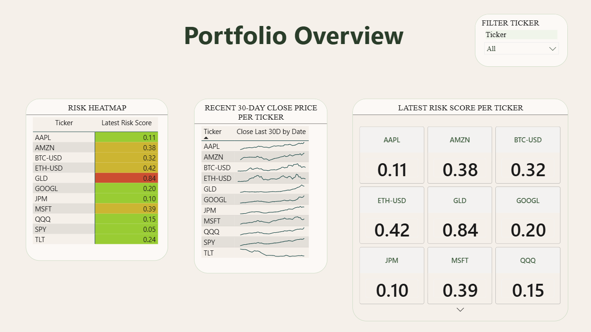

# Financial Risk Monitor

I built this batch pipeline to bring scattered price data, risk calculations and forecasts into one Power BI report. Its strongest evidence is the ingestion and calculation work: handling failed downloads, storing data safely and checking the numbers.

## What I built

Python scripts collect price history from Yahoo Finance and economic indicators from FRED, the Federal Reserve's data service. SQLite stores the results in a local database. The pipeline calculates returns, volatility, falls from previous price peaks, and historical tail-risk measures. Prophet produces price forecasts, while a Monte Carlo simulation samples past returns to explore possible portfolio paths.

The report has four pages: portfolio overview, risk analysis, forecasts and scenario exploration. The current asset list contains 11 equities, exchange-traded funds and cryptocurrencies.

I implemented the pipeline and dashboard work attributed to Tessa-Saumu/Theresia Saumu in the repository history. Adeyeri Michael reviewed and merged changes; I do not claim sole participation in that review process.



## What the checks show

On 13 October 2026, **98 offline tests passed** in an isolated Python 3.12 environment. They cover numerical calculations, repeated database writes and simulated download failures.

The small synthetic demo writes three prices twice and keeps exactly three rows. It checks returns of +10% and −10%, a 10% drawdown, and a −9% historical VaR (Value at Risk: a return threshold taken from the lower tail). These are deliberately simple arithmetic checks, not market-performance results.

## Try it without API keys

From the repository root:

```bash
python -m venv .venv
source .venv/bin/activate        # Windows: .venv\Scripts\activate
python -m pip install -r requirements-lock.txt
python -m pytest tests/ -v
python -m scripts.offline_demo
```

The tests replace external services with controlled responses; the demo creates and removes its own temporary database.

## Run the full pipeline

Copy `.env.example` to `.env` and add your `FRED_API_KEY`. The [FRED setup guide](docs/fred_api_setup.md) explains how. Then run:

```bash
python -m scripts.init_db
python -m scripts.ingest_prices
python -m scripts.ingest_macro
python -m scripts.compute_risk
python -m scripts.run_forecasts
```

Open `dashboard/financial_risk_monitor.pbix` in Power BI Desktop and refresh it using the SQLite ODBC database driver. See the [refresh workflow](docs/data_refresh_workflow.md) and [database schema](docs/schema_diagram.md). Change the asset list in `config.py` if needed.

## Limits

A fresh live-data-to-Desktop refresh was not verified in the October check. Prices reflect the last manual run; there is no live stream or scheduler. The economic indicators are stored but do not drive current calculations or visuals.

The risk calculations and return-sampling simulation are statistical methods, not trained machine-learning models. Forecast results currently come from tuning checks, not a separate final test against a simple forecast baseline. The dashboard sliders adjust existing scores using DAX, Power BI's formula language; they do not rerun the Python simulation. None of this establishes investment performance or measured financial benefit.
